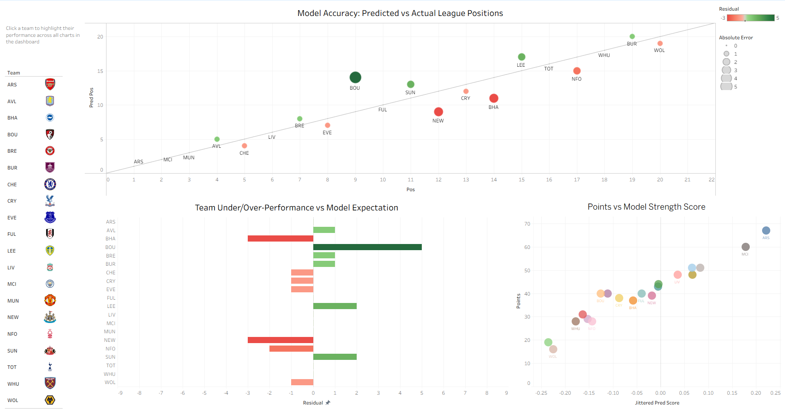

# Premier League Final Position Predictor

This is a machine-learning project that uses a ranking model on historical Premier League
performance data to predict end of season team league positions.

The aim of this project is to rank Premier League teams by their expected
final league position by training historical team-performance features and testing on the current team performance.

### Workflow

1. Collect historical Premier League standings data.
2. Engineer features
3. Train an XGBoost ranking model, run the model on the current season data
4. Compare predicted final positions with actual final positions.
5. Export results for Tableau/Power BI visualisation.

### Data

Data was scraped from the Premier League/PulseLive football API using the WebScrapingMultiSeason script.

### Model

The project uses `XGBRanker` with the `rank:pairwise` objective.

Learning to rank is appropriate because the aim is to order teams from first to
twentieth, rather than predict one independent numerical value per team. Teams
are grouped by season during training so that each 20-team league table is
treated as one ranking problem.

### Evaluation

Model performance is evaluated using:
- Spearman rank correlation — agreement between actual and predicted team order
- Mean absolute error (MAE) — average difference in league positions
- NDCG — ranking quality, with greater importance placed on higher-ranked teams

